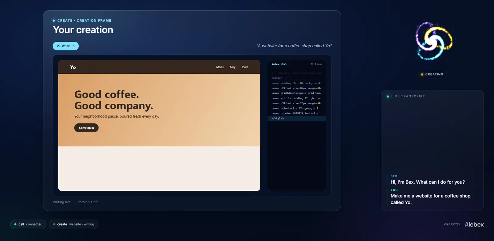
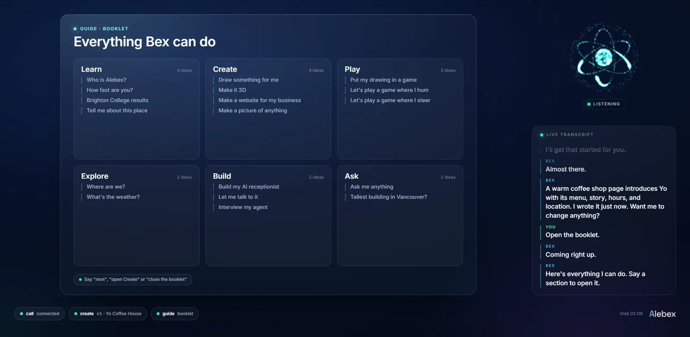
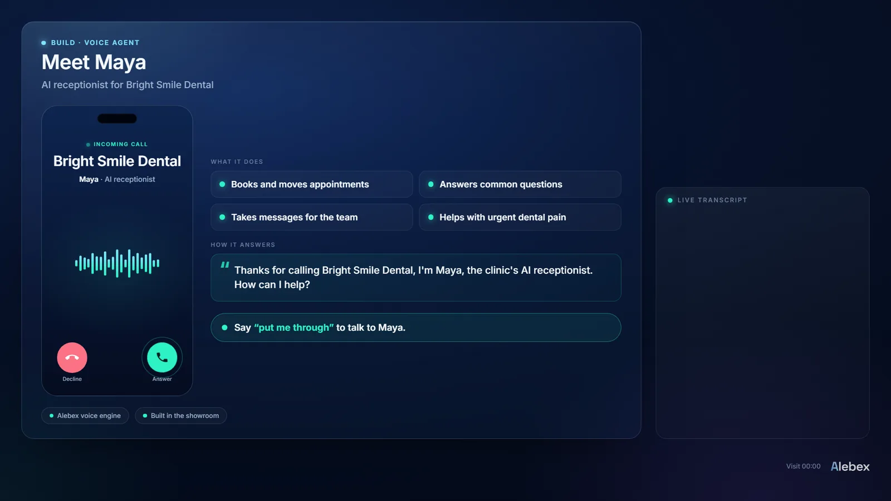
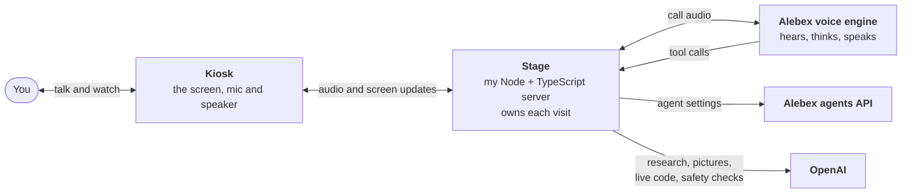

# Meet Bex

Bex is a voice AI host for a showroom screen. You say "Hey Bex" and just talk to her. She answers out loud, and while she talks she puts it all on the screen: research with sources, the weather and where you are, pictures she makes on the spot, drawings and websites she writes while you watch, games your drawing stars in that you steer with your voice, and even a working AI receptionist she builds for your business, then puts you through to or calls to test. When you say goodbye, a QR code takes everything you made home on your phone.

https://github.com/user-attachments/assets/864b018f-c171-47c4-897d-45bcad086b5f

**[Watch the full demo (7 min)](https://behi22.github.io/meet-bex/)**

## Why I built it

I wanted to build something on top of our voice engine at Alebex that shows how far AI can go once it can talk. Not a chatbot you type into, but something closer to a personal Jarvis: you say what you want, and it gets done while you watch.

I built Bex on my own, in my own time, on a regular Alebex developer account. It uses only the public developer docs and the same public APIs every developer gets, with no internal code or inside knowledge. Everything in the demo is something you could build on the platform yourself.

## What you can ask her

| Ask something like | What happens |
|---|---|
| "Who is Alebex?" | A prepared card, and Bex talks over it |
| "Draw me a spaceship", "Make a website for my bakery" | She writes it live, piece by piece, then changes it when you ask. Every version is kept |
| "Put my drawing in a game" | Your drawing becomes the player in a voice game you steer by saying left and right |
| "Where are we?", "What's the weather this weekend?" | Live facts: the place on a globe, the forecast, the time |
| "Build my AI receptionist" | She builds a real voice agent for your business, puts you through to it, or calls it live to test it |
| "What's the tallest building in the world?" | Research with sources, on a card |

| Writing a website live | Everything she can do | An agent she built |
|---|---|---|
|  |  |  |

## In the full demo

| Time | What happens |
|---|---|
| 0:00 | "Hey Bex" |
| 0:26 | The booklet, then a voice-steered game, with the player changed on request |
| 1:51 | Today's weather, where we are, and the weekend forecast |
| 2:40 | The tallest building in the world, then a picture of it made on the spot |
| 3:15 | Bex builds Ava, a booking agent for a dental clinic, and adds her price by voice |
| 4:18 | Bex calls Ava to test her: 2:00 is taken, so Ava books 2:30 and quotes the price |
| 5:39 | Bex's review of the call |
| 5:49 | A coffee shop website, written live, then a logo added to its banner |
| 6:55 | Goodbye |

## How it works

- **The voice engine** runs the conversation. When Bex decides to show something, it calls one of her tools.
- **The stage** answers those tool calls: it runs the tool, sends the result to the screen and hands Bex the words to say over it. It owns the whole visit, so a call can drop and reopen without you noticing.
- **The kiosk** is what you see and hear: the animated orb, the cards, the creations, the live transcript and the games.

## The hard parts

- **Calls that ended on their own.** The engine hangs up when a call goes quiet, and people pause to watch. The stage owns the visit instead of the call, reopens a dropped call with the conversation carried over, and Bex picks up where she left off.
- **Work that takes longer than the engine waits.** A picture or a new agent can take 10 to 30 seconds. Long work runs as a job that outlives the tool call, and Bex keeps talking while it finishes.
- **Code written live by a model, on a public screen.** Every piece is checked before it shows: nothing loads from outside, nothing navigates away, and the words pass a safety check. It runs only inside a locked-down frame.
- **The model picking the wrong tool.** "Play" means different things on different screens. The stage knows what is on screen and checks your actual words, so the right thing happens.
- **Two AI agents on one call.** The test call is two live agents talking, not a script, so the agent you built gets real questions.
- **Steering a game by voice.** Bex's call is put on hold during the game, so she doesn't answer "left" and "right".

## By the numbers

- 2,116 automated tests
- Built in three weeks
- The first piece of a website shows in about 3 seconds
- A full demo costs about $2, almost all of it voice minutes

## Built with

TypeScript, Node.js, Vite and Vitest, the Alebex voice engine, agents API and speech recognition, and OpenAI models for research, pictures and live code. It runs on a small Linux server behind Caddy.

## About the code

The source stays private, because it runs a live kiosk with real keys. This repo is the showcase. If you want a walkthrough, [reach out on LinkedIn](https://www.linkedin.com/in/behbod-babai).
